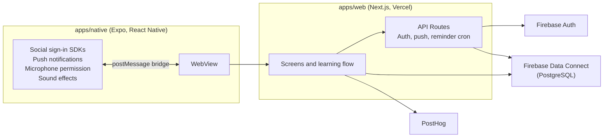

<p align="center">
  
</p>

<h3 align="center">A Bible memorization app: one verse a day, learned in 7 steps</h3>

<p align="center">
  <a href="https://apps.apple.com/kr/app/tolli/id6766518023">App Store</a> |
  <a href="https://play.google.com/store/apps/details?id=com.company.tolli">Google Play</a>
</p>

<p align="center">
  <strong>Language:</strong> <a href="README.md">한국어</a> | English
</p>

<br>

## Why we built it

> Don't lock it inside an app. Let it seep into daily life.

There are plenty of Bible memorization apps, but few people keep using them.

Signing in, choosing verses, and setting up progress and plans wears you out before you memorize anything.

Instead of adding features, tolli takes them away.

- You memorize just one verse a day.
- It fits in short gaps, like a minute on the subway or before bed.
- Today's verse is already chosen, so there is nothing to plan.

<br>

## Learning flow

Each verse is memorized over 7 steps, with more of it hidden at each step.

<p align="center">
  
  
  
  
  
</p>


| Step | What you do |
|:---:|---|
| 1 | Tap each word to read the verse and see word meanings |
| 2 ~ 5 | Fill in hidden parts with a 3-choice quiz. More is hidden at each step |
| 6 | Type the verse on a custom keyboard with only the initial consonants shown |
| 7 | Read the verse aloud and record it |

Leaving mid-session is not saved, and you start over from the beginning.
This rule is intentional, to keep you focused on one verse.

**Other features**

- Study reminders (fixed time or custom time)
- Favorites
- Today's mission dashboard
- Google, Apple, and Kakao sign-in

<br>

## Architecture

Screens are built as a web app (Next.js), and a React Native (Expo) app shows that web app in a WebView.

Native handles only what the web cannot, and the two talk through messages.



### Why a WebView hybrid

**What we gained**

- One web codebase for screens, shipped to both iOS and Android.
- Fixing the learning flow only needs a web deploy, so changes go live without waiting for store review.

**What we accepted**

- An app that only wraps a website can be rejected in store review.
- So sign-in, push notifications, microphone permission, and sound effects are implemented natively.
- The messages between web and app have to be managed by hand.

### Messages between web and app

Bridge handling lives in [`apps/native/App.tsx`](apps/native/App.tsx).

| Message | Purpose |
|---|---|
| `GOOGLE_LOGIN`<br>`APPLE_LOGIN`<br>`KAKAO_LOGIN` | Handles social sign-in that WebView blocks with native SDKs and returns the token |
| `REQUEST_NOTIFICATION_PERMISSION`<br>`QUERY_PERMISSION_STATUS` | Requests notification and microphone permissions and checks their status |
| `GET_EXPO_PUSH_TOKEN` | Gets the push token and registers it with the server |
| `PLAY_SOUND` | Plays sound effects bundled in the app |
| `GET_APP_VERSION`<br>`OPEN_STORE` | Sends users to the store to update when below the minimum supported version |

### Learning steps are split by URL

The learning screen path is `study/[verseId]/[step]`.

The `switch` in [`page.tsx`](apps/web/src/app/study/%5BverseId%5D/%5Bstep%5D/page.tsx) renders only the component that matches `step`.

Step components do not know about each other.
Changing one step does not affect the others.

<br>

## Tech stack

| Area | Choice | Why |
|---|---|---|
| Web | Next.js 15 (App Router)<br>React 19, TypeScript 5 | Renders HTML on the server first, so the WebView never shows a blank screen on first load |
| Styling | Tailwind CSS 4 | Device sizes vary, so layouts use relative units like `rem` and `vw` |
| App | React Native 0.81<br>Expo 54 | Only push and microphone are needed, so Expo keeps native setup cost low |
| Data | Firebase Auth<br>Firebase Data Connect (PostgreSQL) | Schema and queries are defined in GraphQL with no separate backend server, and a typed SDK is generated from them |
| Analytics | PostHog | Tracks drop-off per step as a funnel and runs A/B tests |
| Repo | pnpm workspace monorepo | Web and app changes are reviewed together in one PR |
| CI | GitHub Actions | Runs typecheck, lint, and build on every PR |

<br>

## Folder structure

```
apps/
├─ web/                        Next.js web (the screens the WebView loads)
│  ├─ src/app/
│  │  ├─ onboarding/           Onboarding right after sign-up
│  │  ├─ dashboard/            Today's mission, favorites
│  │  ├─ study/[verseId]/[step]/
│  │  │  └─ _components/
│  │  │     ├─ step1/          Tap words to read
│  │  │     ├─ step2-5/        3-choice quiz on hidden parts
│  │  │     ├─ step6/          Initial-consonant typing
│  │  │     └─ step7/          Recording
│  │  └─ api/                  Auth, push tokens, reminder cron
│  └─ scripts/                 Image conversion scripts
└─ native/                     Expo app (WebView shell)
   ├─ auth/                    Google and Apple sign-in
   ├─ modules/corner-radius/   Native module that reads the device corner radius
   └─ plugins/                 Expo config plugins (sound bundling, SDK versions)
dataconnect/                   Data Connect schema, queries, verse seed data
```

<br>

## Run

Requires Node 24 and pnpm 9.

```bash
pnpm install

pnpm web        # Web dev server (localhost:3000)
pnpm ios        # iOS app (Development Build)
pnpm android    # Android app (Development Build)
```

- The web app needs Firebase, PostHog, and social sign-in keys in `apps/web/.env`.
- Social sign-in uses native SDKs, so it works in a Development Build, not in Expo Go.
