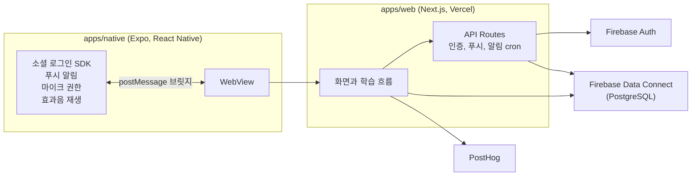

<p align="center">
  
</p>

<h3 align="center">하루 한 절, 7단계로 외우는 성경 암송 앱</h3>

<p align="center">
  <a href="https://apps.apple.com/kr/app/tolli/id6766518023">App Store</a> |
  <a href="https://play.google.com/store/apps/details?id=com.company.tolli">Google Play</a>
</p>

<br>

## 왜 만들었나

> 앱 안에 가두지 않는다. 스며들게 한다.

성경 암송 앱은 이미 많지만 잘 쓰이지 않습니다.

로그인하고, 구절을 고르고, 진도와 계획을 정하다 보면 외우기도 전에 지칩니다.

tolli는 기능을 더하는 대신 덜어냈습니다.

- 하루에 한 절만 외웁니다.
- 지하철이나 잠들기 전 1분 같은 짧은 틈에 끝납니다.
- 계획을 세우지 않아도 오늘 외울 구절이 정해져 있습니다.

<br>

## 학습 흐름

한 구절을 7단계에 걸쳐 조금씩 가려 가며 외웁니다.

<!-- TODO 사진 2: 단계별 화면 4장 (1단계, 2~5단계, 6단계, 7단계) 또는 학습 과정 GIF -->

| 단계 | 하는 일 |
|:---:|---|
| 1 | 단어를 하나씩 눌러 구절을 읽고 단어 뜻을 봅니다 |
| 2 ~ 5 | 가려진 부분을 3지선다로 맞힙니다. 단계가 오를수록 더 많이 가려집니다 |
| 6 | 초성만 보고 전용 키보드로 구절을 입력합니다 |
| 7 | 구절을 소리 내어 읽고 녹음합니다 |

학습 도중에 나가면 저장되지 않고 처음부터 다시 시작합니다.
한 구절에 집중하게 하려고 일부러 둔 규칙입니다.

**그 밖의 기능**

- 학습 알림 (고정 시간, 사용자 지정 시간)
- 즐겨찾기
- 오늘의 미션 대시보드
- Google, Apple, Kakao 로그인

<br>

## 아키텍처

화면은 웹(Next.js)으로 만들고, React Native(Expo) 앱이 그 웹을 WebView로 띄웁니다.

웹에서 할 수 없는 일만 네이티브가 맡고, 둘은 메시지로 대화합니다.



### 왜 WebView 하이브리드인가

**얻은 것**

- 화면을 웹 하나로 만들어 iOS와 Android에 같이 내보냅니다.
- 학습 흐름을 고쳐 웹만 배포하면 스토어 심사를 기다리지 않고 바로 반영됩니다.

**감수한 것**

- 웹만 감싼 앱은 스토어 심사에서 거절될 수 있습니다.
- 그래서 로그인, 푸시 알림, 마이크 권한, 효과음은 네이티브로 구현했습니다.
- 웹과 앱이 주고받는 메시지를 직접 관리해야 합니다.

### 웹과 앱이 주고받는 메시지

브릿지 처리는 [`apps/native/App.tsx`](apps/native/App.tsx)에 모여 있습니다.

| 메시지 | 용도 |
|---|---|
| `GOOGLE_LOGIN`<br>`APPLE_LOGIN`<br>`KAKAO_LOGIN` | WebView에서 막히는 소셜 로그인을 네이티브 SDK로 처리하고 토큰을 돌려줍니다 |
| `REQUEST_NOTIFICATION_PERMISSION`<br>`QUERY_PERMISSION_STATUS` | 알림과 마이크 권한을 요청하고 현재 상태를 확인합니다 |
| `GET_EXPO_PUSH_TOKEN` | 푸시 토큰을 받아 서버에 등록합니다 |
| `PLAY_SOUND` | 앱에 내장한 효과음을 재생합니다 |
| `GET_APP_VERSION`<br>`OPEN_STORE` | 최소 지원 버전보다 낮으면 스토어 업데이트로 안내합니다 |

### 학습 단계는 URL로 나눈다

학습 화면 경로는 `study/[verseId]/[step]`입니다.

[`page.tsx`](apps/web/src/app/study/%5BverseId%5D/%5Bstep%5D/page.tsx)의 `switch`가 `step` 값에 맞는 컴포넌트 하나만 그립니다.

단계 컴포넌트끼리는 서로를 모릅니다.
한 단계를 고쳐도 다른 단계에 영향이 가지 않습니다.

<br>

## 기술 스택

| 영역 | 선택 | 왜 |
|---|---|---|
| 웹 | Next.js 15 (App Router)<br>React 19, TypeScript 5 | WebView에 처음 들어올 때 흰 화면이 보이지 않게 서버에서 HTML을 먼저 그립니다 |
| 스타일 | Tailwind CSS 4 | 기기 크기가 다양해 `rem`, `vw` 같은 상대 단위로 맞춥니다 |
| 앱 | React Native 0.81<br>Expo 54 | 푸시와 마이크 정도만 필요해 네이티브 설정 비용이 낮은 Expo를 골랐습니다 |
| 데이터 | Firebase Auth<br>Firebase Data Connect (PostgreSQL) | 별도 백엔드 서버 없이 스키마와 쿼리를 GraphQL로 정의하고, 타입이 붙은 SDK를 생성해 씁니다 |
| 분석 | PostHog | 단계별 이탈을 퍼널로 보고 A/B 테스트를 돌립니다 |
| 저장소 | pnpm workspace 모노레포 | 웹과 앱의 변경을 한 PR에서 같이 봅니다 |
| CI | GitHub Actions | PR마다 타입 검사, 린트, 빌드를 돌립니다 |

<br>

## 폴더 구조

```
apps/
├─ web/                        Next.js 웹 (WebView가 띄우는 화면)
│  ├─ src/app/
│  │  ├─ onboarding/           가입 직후 온보딩
│  │  ├─ dashboard/            오늘의 미션, 즐겨찾기
│  │  ├─ study/[verseId]/[step]/
│  │  │  └─ _components/
│  │  │     ├─ step1/          단어 눌러 읽기
│  │  │     ├─ step2-5/        가려진 부분 3지선다
│  │  │     ├─ step6/          초성 타이핑
│  │  │     └─ step7/          녹음
│  │  └─ api/                  인증, 푸시 토큰, 알림 cron
│  └─ scripts/                 이미지 변환 스크립트
└─ native/                     Expo 앱 (WebView 셸)
   ├─ auth/                    Google, Apple 로그인
   ├─ modules/corner-radius/   기기 모서리 곡률을 읽는 네이티브 모듈
   └─ plugins/                 Expo config plugin (효과음 번들, SDK 버전)
dataconnect/                   Data Connect 스키마, 쿼리, 구절 시드
```

<br>

## 실행

Node 24, pnpm 9가 필요합니다.

```bash
pnpm install

pnpm web        # 웹 개발 서버 (localhost:3000)
pnpm ios        # iOS 앱 (Development Build)
pnpm android    # Android 앱 (Development Build)
```

- 웹은 `apps/web/.env`에 Firebase, PostHog, 소셜 로그인 키가 있어야 뜹니다.
- 소셜 로그인은 네이티브 SDK를 쓰기 때문에 Expo Go가 아니라 Development Build에서 동작합니다.
